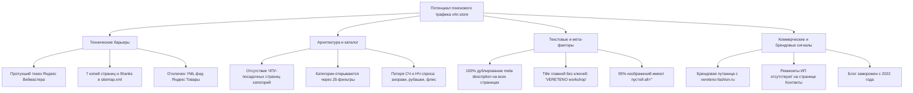
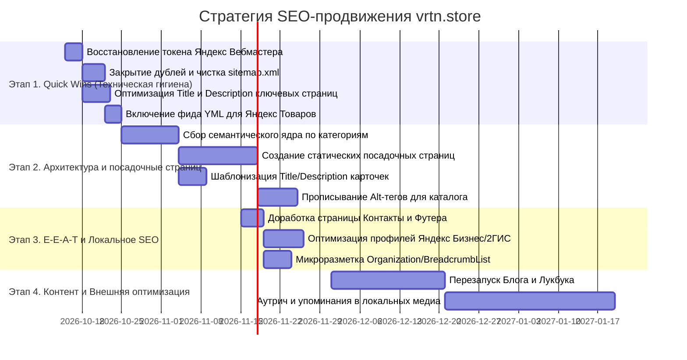
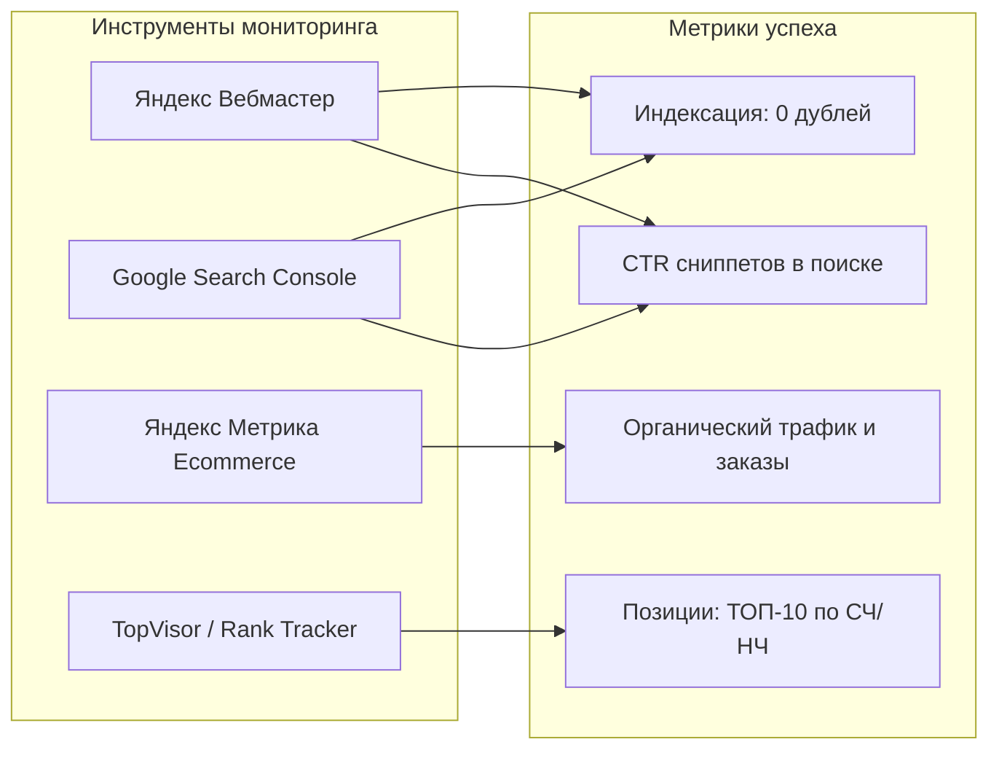

# Комплексный SEO-анализ и стратегия поискового продвижения бренда VERETENO (vrtn.store)

> **Проект:** VERETENO (`vrtn.store` / Tilda Project ID: `4296338`)  
> **Дата анализа:** Октябрь 2026 г.  
> **CMS / Платформа:** Tilda Publishing (Store Engine)  
> **Тип сайта:** Интернет-магазин женской повседневной одежды (локальный бренд из Сибири, собственное производство, онлайн-продажи + шоурумы)

---

## 1. Резюме аудита: Главные точки роста и критические проблемы

В ходе глубокого анализа текущего состояния сайта, структуры Tilda MCP, настроек сервера и живой выдачи были выявлены как сильные стороны проекта, так и критические ограничения, сдерживающие органический трафик из Яндекса и Google.



---

## 2. Детальный аудит по направлениям

### 2.1. Технический SEO (Индексация, сканирование, сервер)

| Параметр | Текущее состояние | Оценка | Риск / Влияние на ранжирование |
| :--- | :--- | :---: | :--- |
| **Связка с Яндекс Вебмастером** | Токен авторизации истек (`expired_token: invalid_grant`) | 🔴 Критично | Tilda не отправляет актуальные сигналы, владелец не видит ошибок обхода, проблем с мобильной версией и поисковых запросов в Яндексе. |
| **Google Search Console** | Интеграция выключена (`googlewebmaster_activate: no`) | 🟡 Средне | Нет прямого мониторинга индексации и Core Web Vitals в Google. |
| **Мусорные дубли в sitemap.xml** | В карту сайта включены копии страниц: `page297725109.html`, `page297725509.html`, `page297725609.html`, `page297725709.html`, `page297725809.html`, `page298348809.html`, `page298349009.html` и страница заказа `/thanks` | 🔴 Критично | Размытие краулингового бюджета роботов, появление дублированного контента в индексе, попадание страниц подтверждения заказов в поисковую выдачу. |
| **Устаревшие сезонные страницы** | В sitemap отдаются старые разделы: `/catalog/autumn21`, `/catalog/autumn`, `/catalog/leto22` | 🟡 Средне | Индексируются страницы 2021–2022 года с неактуальными товарами и остатками. |
| **Robots.txt** | Автоматический, режим ручного редактирования выключен. Копии страниц и `/thanks` не закрыты | 🔴 Высоко | Поисковые краулеры беспрепятственно обходят черновые копии. |
| **Зеркала и редиректы** | `http://` ➔ `https://` (301), `www` ➔ `без www` (301 в один шаг) | 🟢 Отлично | Главное зеркало настроено эталонно, дублирования домена нет. |
| **Обработка 404 ошибки** | Сервер возвращает `HTTP/1.1 404 Not Found` | 🟢 Отлично | Мягких 404 (Soft 404) не обнаружено. |
| **Канонические адреса (Canonical)** | Присутствует самореферентный `<link rel="canonical">` | 🟢 Хорошо | Помогает сглаживать дубли со слешем (`/catalog/` ➔ `/catalog`). |
| **Товарный фид YML** | Отключен (`active: 0`) | 🔴 Критично | Сайт не транслирует каталог в сервис «Яндекс Товары», упуская расширенные сниппеты с ценами и кнопками в поиске. |

---

### 2.2. Архитектура каталога и структуры страниц

1. **Главная проблема e-commerce архитектуры:**
   - В текущей структуре Tilda Store все категории каталога (*«Анораки»*, *«Рубашки и топы»*, *«Изделия из флиса»*, *«Брюки и юбки»*, *«Верхняя одежда»*, *«Аксессуары»*) не имеют собственных статических страниц с ЧПУ-адресами.
   - Ссылки из меню ведут на динамические фильтры вида:  
     `https://vrtn.store/catalog?tfc_storepartuid[333573669]=Анораки&tfc_div=:::`
   - На странице `/catalog` установлен каноникал на самого себя (`href="https://vrtn.store/catalog"`). В результате роботы считают любые параметры фильтров неканоническими и **не создают в выдаче отдельные страницы для категорий**.
   - **Итог:** Сайт не может выйти в ТОП по категорийным запросам: *«купить женский анорак»*, *«дизайнерские женские брюки»*, *«одежда из флиса»*, *«рубашки в клетку оверсайз»*.

2. **Несоответствие структуры разделов:**
   - В Tilda часть товаров подвязана к старому адресу: например, раздел *«Изделия из флиса»* закреплен за страницей `page20639786` с URL `/catalog/len` (бывшая *«Льняная коллекция»*). Это сбивает с толку и пользователей, и поисковые алгоритмы.

---

### 2.3. On-Page оптимизация и мета-теги

1. **Тотальный дубль Description:**
   - На страницах `/`, `/catalog`, `/delivery`, `/contacts`, `/lookbook` и даже в технических копиях прописан одинаковый Description:
     > *«Женская повседневная одежда, созданная в Сибири. Актуальный крой, натуральные и смесовые ткани природных оттенков.»*
   - Это приводит к сквозному дублированию мета-тегов в отчете Яндекс Вебмастера.
2. **Неоптимизированные заголовки Title:**
   - Главная: `VERETENO workshop` (нет упоминания женской одежды, российского бренда, интернет-магазина).
   - Каталог: `Каталог товаров | VERETENO` (слишком общий, не отражает специфику).
   - Карточки товаров: `Парка | Фисташка` (название бренда VERETENO и слово «женская» отсутствуют). При попадании в выдачу сниппет выглядит безлико.
3. **Структура заголовков H1-H3:**
   - Главная страница: заголовок первого уровня назначен тексту:  
     `<h1>Привет, мы рады тебе здесь! :)</h1>`  
     Вместо коммерческого и тематического H1 поисковик считывает нерелевантную фразу.
   - Каталог: `<h1>Каталог</h1>` — нет семантического веса.
4. **Атрибуты Alt у изображений (Визуальный поиск):**
   - На проверенных страницах более **90% изображений имеют пустой атрибут `alt=""`**.
   - Для fashion-сегмента это колоссальная потеря, так как миллионы покупателей ищут фасоны через Яндекс Картинки и Google Images.

---

### 2.4. Брендовый спрос и локальное SEO (E-E-A-T)

1. **Коллизия двух брендов VERETENO:**
   - В Рунете работают два созвучных бренда:
     1. `VERETENO workshop` (`vrtn.store`) — Сибирь, Хакасия (Саяногорск, Абакан), современный кэжуал из натуральных тканей, основатель Вера Ананьева.
     2. `VERETENO fashion` (`vereteno-fashion.ru`) — Москва, дизайнер Людмила Мезенцева, размеры 42–64, работает с 1999 года.
   - Пользователи, вводящие «бренд веретено», «одежда веретено», часто попадают к конкуренту из Москвы. Сайту жизненно необходима четкая отстройка: везде закреплять маркеры **«VERETENO workshop»**, **«vrtn.store»**, **«Сибирский бренд»**, **«дизайнерская одежда VERETENO»**.
2. **Коммерческие факторы страницы «Контакты»:**
   - На странице `/contacts` указан телефон и соцсети, но **нет блока реквизитов**: ИП Ананьев М.А., ИНН 190207495060, ОГРНИП. Они есть только в тексте оферты.
   - Для коммерческого алгоритма Яндекса (фильтр коммерческих факторов) наличие ИНН/ОГРН, точного юридического адреса, графика работы шоурумов и карты прямо на странице контактов и в футере обязательно.
3. **Блог и Lookbook:**
   - Раздел `/blog` не обновлялся с февраля 2022 года (всего 2 записи).
   - Лукбук содержит фотографии, но не оптимизирован текстами (нет описания капсул, трендов, сочетаемости цветов).

---

## 3. Стратегия поискового продвижения (SEO Roadmap)

Стратегия разделена на 4 последовательных этапа: от срочной ликвидации технических рисков до масштабирования структуры и контент-маркетинга.



---

### Этап 1: Quick Wins — Техническая гигиена (Срок: 1–2 недели)

1. **Восстановление связки с вебмастерами:**
   - Переавторизовать токен Яндекс Вебмастера в Tilda (устранить ошибку `expired_token`).
   - Подключить проект к **Google Search Console** через DNS-запись TXT или мета-тег в Tilda.
2. **Чистка дублей и изоляция технического мусора:**
   - Для всех страниц-копий (`page297725109.html`, `page297725509.html`, `page297725609.html`, `page297725709.html`, `page297725809.html`, `page298348809.html`, `page298349009.html`): перевести в статус «не опубликовано» (черновик) либо включить чекбокс *«Запретить поисковикам индексировать эту страницу»* (`nosearch: "y"`).
   - Закрыть страницу `/thanks` от индексации (`nosearch: "y"`).
   - В `robots.txt` добавить явные запреты:
     ```text
     Disallow: /thanks
     Disallow: /page*.html
     Clean-param: tfc_storepartuid&tfc_div /catalog
     ```
3. **Подключение Яндекс Товаров (YML):**
   - Активировать YML-коннектор в Tilda Store.
   - Сгенерировать ссылку фида (`https://vrtn.store/...yml`) и загрузить её в Яндекс Вебмастер в раздел **«Товары и предложения» ➔ «Источники данных»**.
   - Это бесплатно выведет товары VERETENO в товарную карусель Яндекса.
4. **Устранение дублей мета-тегов и исправление H1:**
   - **Главная (`/`):**
     - **Title:** `VERETENO — сибирский бренд женской одежды | Официальный интернет-магазин`
     - **Description:** `Дизайнерская женская одежда от сибирского бренда VERETENO: анораки, брюки, рубашки оверсайз, флисовые костюмы. Натуральные ткани, собственное производство, доставка по всей России.`
     - **H1:** `VERETENO — женская повседневная одежда, созданная в Сибири`
   - **Каталог (`/catalog`):**
     - **Title:** `Каталог женской одежды VERETENO — купить стильные вещи от производителя`
     - **Description:** `Полный каталог женской одежды VERETENO: верхняя одежда, костюмы, рубашки, платья и трикотаж. Актуальный крой и природные оттенки. Заказывайте с примеркой и доставкой.`
     - **H1:** `Каталог дизайнерской женской одежды`
   - **Доставка (`/delivery`):**
     - **Title:** `Доставка, оплата и условия возврата заказов | VERETENO`
     - **Description:** `Условия доставки интернет-магазина VERETENO по всей России (СДЭК, Почта России). Способы онлайн-оплаты, примерка, простой возврат и обмен в течение 14 дней.`
   - **Контакты (`/contacts`):**
     - **Title:** `Контакты бренда VERETENO — шоурумы, интернет-магазин, реквизиты`
     - **Description:** `Контакты интернет-магазина VERETENO: телефон +7 (983) 196-09-04, email info@vrtn.store. Адреса шоурумов в Саяногорске и Абакане, служба заботы в Telegram и WhatsApp.`

---

### Этап 2: Архитектура каталога и расширение семантики (Срок: 3–5 недель)

1. **Создание полноценных посадочных страниц категорий (Category Hubs):**
   - Создать на Tilda статические страницы категорий с постоянными ЧПУ:
     - `/catalog/anoraki` — Женские анораки
     - `/catalog/rubashki` — Рубашки и топы
     - `/catalog/flis` — Одежда из флиса (перенести с `/catalog/len`, настроив 301 редирект)
     - `/catalog/bryuki` — Брюки и юбки
     - `/catalog/outerwear` — Верхняя одежда (парки, куртки, ветровки)
     - `/catalog/knitwear` — Вязаный трикотаж и шапки
     - `/catalog/sets` — Комплекты и костюмы
   - На каждой странице разместить:
     - Уникальный оптимизированный H1 и вводный текст (2-3 абзаца с естественными ключами о крое, тканях и комфорте).
     - Блок витрины товаров (ST300/каталог) с предустановленным фильтром этой категории.
     - Уникальные мета-теги Title и Description.
   - В главное меню и футер подставить ссылки на эти статические страницы вместо `?tfc_storepartuid[...]`.
2. **Оптимизация карточек товаров (Шаблоны мета-тегов):**
   - Заполнить во всех карточках поле `brand: "VERETENO"`.
   - Внедрить правило формирования Title для товаров:  
     `[Название товара] [Цвет] — купить женский [тип изделия] | VERETENO`  
     *Пример:* `Парка оверсайз Фисташка — купить женскую парку | VERETENO workshop`
3. **Заполнение Alt-тегов для изображений:**
   - В галереях каталога и лукбука прописать описательные теги Alt с ключевыми словами:  
     *«Осенняя женская парка фисташкового цвета свободного кроя VERETENO»*,  
     *«Женские джоггеры графит из плотного нейлона»*.

---

### Этап 3: E-E-A-T, доверие и локальное присутствие (Срок: 2–3 недели)

1. **Укрепление доверия на странице «Контакты» и в футере:**
   - Добавить блок:  
     > **Реквизиты продавца:**  
     > ИП Ананьев Максим Андреевич  
     > ИНН: 190207495060 | ОГРНИП: 319190100012453  
     > Юридический адрес: Республика Хакасия, г. Саяногорск  
     > Шоурумы: г. Саяногорск (адрес, часы работы), г. Абакан (адрес, часы работы).  
     > Телефон: +7 (983) 196-09-04 | Email: info@vrtn.store
   - Разместить интерактивную Яндекс Карту с отметками шоурумов.
2. **Синхронизация с геосервисами:**
   - Привязать карточки шоурумов в **Яндекс Бизнес (Карты)** и **2ГИС** к сайту `https://vrtn.store`.
   - В Яндекс Вебмастере подтвердить региональную принадлежность (Хакасия, Красноярский край, Сибирь + доставка по всей РФ).
3. **Разметка Schema.org:**
   - Внедрить через HTML-код в `head` микроразметку `Organization`:
     ```json
     {
       "@context": "https://schema.org",
       "@type": "ClothingStore",
       "name": "VERETENO workshop",
       "url": "https://vrtn.store",
       "logo": "https://static.tildacdn.com/tild3563-3238-4131-a434-616637363764/Group_548.png",
       "telephone": "+79831960904",
       "email": "info@vrtn.store",
       "address": {
         "@type": "PostalAddress",
         "addressLocality": "Саяногорск",
         "addressRegion": "Республика Хакасия",
         "addressCountry": "RU"
       },
       "sameAs": [
         "https://vk.com/vrtnworkshop",
         "https://t.me/vrtnworkshop"
       ]
     }
     ```

---

### Этап 4: Контент-стратегия и ссылочный профиль (Срок: 2–4 месяца)

1. **Оживление Блога под информационные поисковые кластеры:**
   - Публиковать по 2–3 экспертные статьи в месяц на темы:
     - *«Как собрать капсульный гардероб на осень из натуральных тканей»*
     - *«С чем носить женский анорак: 5 стильных образов на каждый день»*
     - *«Одежда из флиса: уход, выбор плотности и многослойные образы»*
     - *«Сибирские бренды одежды: философия комфорта и уюта»*
   - Из статей делать перелинковку (ссылки с коммерческими анкорами) на карточки товаров и категории каталога.
2. **Брендовые упоминания и ссылки (Digital PR):**
   - Размещение в подборках «Локальные российские бренды одежды», «Бренды Сибири», фешн-каналах Telegram.
   - Регистрация в проверенных тематических каталогах российских производителей одежды (с проверкой ИНН).

---

## 4. Система контроля и проверки эффективности (KPI & Monitoring)

Чтобы изменения приносили измеримый бизнес-результат, внедряется трёхуровневая система мониторинга.



### 4.1. Ключевые метрики эффективности (KPI)

| Показатель | Исходное значение (Октябрь 2026) | Целевое значение (3 мес.) | Целевое значение (6 мес.) | Метод замера |
| :--- | :---: | :---: | :---: | :--- |
| **Качество индекса (Индексные дубли)** | 7+ копий страниц и `/thanks` в sitemap | 0 дублей, только чистые ЧПУ | 0 дублей | Яндекс Вебмастер ("Страницы в поиске") |
| **Ошибки сканирования** | Токен отвязан, дубли мета-тегов | 0 критических ошибок | 0 критических ошибок | Яндекс Вебмастер / GSC |
| **Товары в поиске Яндекса (YML)** | 0 товаров (фид отключен) | 100% активных товаров | 100% активных товаров | Раздел "Товары и предложения" |
| **CTR сниппетов в поиске** | Базовый (~1.5–2.5%) | +30–40% к CTR | +60% к CTR | Раздел "Поисковые запросы" Вебмастера |
| **Видимость по СЧ/НЧ кластерам** | Вне ТОП-50 по категориям | ТОП-15–20 по ядру категорий | ТОП-5–10 по категориям | Сервис съема позиций (TopVisor/Keys.so) |
| **Брендовая монополия** | Конкуренция с `vereteno-fashion.ru` | ТОП-1–2 по всем запросам со словом «workshop» / Сибирь | ТОП-1 по брендовым комбинациям | Поисковая выдача Яндекса и Google |
| **Органический поисковый трафик** | Текущий базовый уровень | +50% целевых визитов | +120–150% целевых визитов | Яндекс Метрика (отчет "Поисковые системы") |
| **Органические конверсии (Заказы)** | Текущий базовый уровень | +35% заказов с органики | +80–100% заказов | Электронная коммерция Яндекс Метрики |

---

### 4.2. План контрольных замеров и верификации шагов

1. **Чекпоинт 1 (Через 7 дней после внедрения Этапа 1):**
   - Проверка статуса токена Яндекс Вебмастера.
   - Проверка файла `sitemap.xml` на отсутствие копий `page*.html` и страницы `/thanks`.
   - Проверка отчета «Заголовки и описания» в Вебмастере на исчезновение дублей Description.
2. **Чекпоинт 2 (Через 21 день):**
   - Проверка статуса модерации YML-фида в кабинете «Яндекс Товары».
   - Первичный срез CTR сниппетов для обновленных страниц (Главная, Каталог, Контакты).
3. **Чекпоинт 3 (Через 45 дней после запуска страниц категорий):**
   - Контроль индексации новых ЧПУ-страниц (`/catalog/anoraki`, `/catalog/flis` и др.).
   - Снятие позиций по семантическому ядру категорий в Яндексе и Google.
4. **Чекпоинт 4 (Через 90 дней):**
   - Сравнительный анализ органического трафика и доходности (Ecommerce) по сравнению с базовым периодом.
   - Корректировка семантики и мета-тегов страниц, не вошедших в ТОП-10.
